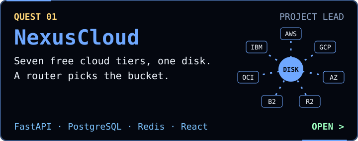
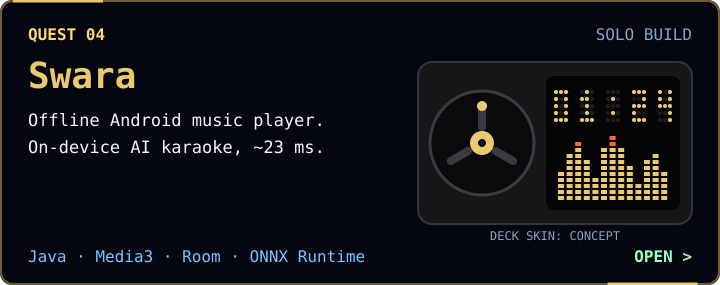
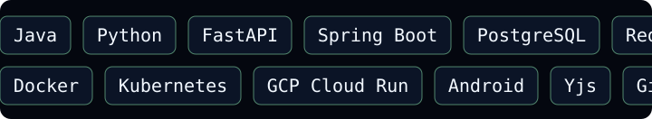

# Prabhu Siddarth A V

  

[Portfolio](https://prabhusiddarth.dev) · [Resume](https://prabhusiddarth.dev/resume.pdf) · [LinkedIn](https://www.linkedin.com/in/prabhu-siddarth-av/) · [Email](mailto:prabhusiddarth37@gmail.com) · [YouTube](https://www.youtube.com/@psthetech)

  

  

  

  

  

  

  

  

  

  <picture>
    <source media="(prefers-color-scheme: dark)" srcset="https://raw.githubusercontent.com/PRABHUSIDDARTH/PRABHUSIDDARTH/output/github-contribution-grid-snake-dark.svg" />
    
  </picture>

  

  

  

