# Prabhu Siddarth A V

AI backend engineer in the making. B.Tech IT, 2028.

[Portfolio](https://prabhusiddarth.dev) · [Resume](https://prabhusiddarth.dev/resume.pdf) · [LinkedIn](https://www.linkedin.com/in/prabhu-siddarth-av/) · [Email](mailto:prabhusiddarth37@gmail.com) · [YouTube](https://www.youtube.com/@psthetech)

  

## Flagships

### [NexusCloud](https://github.com/NexusCloud-Orchestra/NexusCloud-Orchestra) · seven free tiers, one disk
Connect your own accounts on seven clouds; a router scores each upload and the file goes straight to the chosen bucket. 
**Project lead** (backend core, Smart Router, DevOps) 
`FastAPI` `PostgreSQL` `Redis` `React` `Docker`

### [sidd-ai](https://github.com/PRABHUSIDDARTH/sidd-ai) · any AI model, one line of Java
Open-source SDK for 8 AI providers, on Maven Central with 600+ downloads. No Spring needed. 
**Creator and maintainer** 
`Java 17` `Maven Central` `JUnit 5` `Apache 2.0`

### [Coedit](https://github.com/PRABHUSIDDARTH/coedit) · write together, draft specs with a model council
Live docs, sheets and drawings, plus an AI council on your own API key. Runs locally with Docker Compose; not deployed yet. 
**Solo build** 
`Next.js` `Yjs` `FastAPI` `PostgreSQL`

### [Swara](https://github.com/PRABHUSIDDARTH/SwaraApp) · an offline Android music player with on-device AI
Live vocal removal for karaoke (about 23 ms added latency) and on-device voice commands, with no account. 
**Solo build** 
`Java` `Media3` `Room` `ONNX Runtime`

## Stack

`Java` `Python` `FastAPI` `Spring Boot` `PostgreSQL` `Redis` `Docker` `Kubernetes` `GCP Cloud Run`

## Problem solving

  

